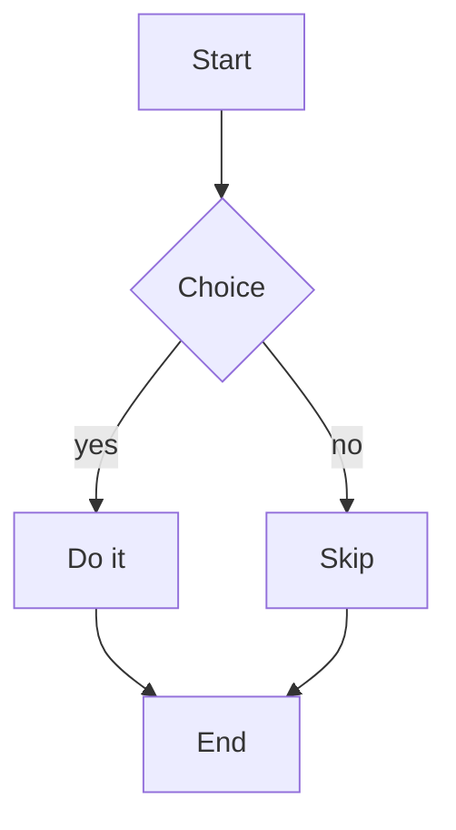
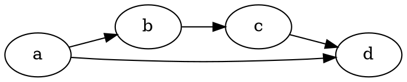

# Long Print Fixture

A multi-page document for checking page breaks: a tall table, a long code block, diagrams near page ends, callouts and long prose.

## Section 1

Lorem ipsum dolor sit amet, consectetur adipiscing elit, sed do eiusmod tempor incididunt ut labore et dolore magna aliqua. Ut enim ad minim veniam, quis nostrud exercitation ullamco laboris nisi ut aliquip ex ea commodo consequat. Duis aute irure dolor in reprehenderit in voluptate velit esse cillum dolore eu fugiat nulla pariatur.

Lorem ipsum dolor sit amet, consectetur adipiscing elit, sed do eiusmod tempor incididunt ut labore et dolore magna aliqua. Ut enim ad minim veniam, quis nostrud exercitation ullamco laboris nisi ut aliquip ex ea commodo consequat. Duis aute irure dolor in reprehenderit in voluptate velit esse cillum dolore eu fugiat nulla pariatur.
### Tall table

| # | Name | Value | Notes |
|---|------|-------|-------|
| 1 | item-1 | 37 | row 1 of the tall table |
| 2 | item-2 | 74 | row 2 of the tall table |
| 3 | item-3 | 10 | row 3 of the tall table |
| 4 | item-4 | 47 | row 4 of the tall table |
| 5 | item-5 | 84 | row 5 of the tall table |
| 6 | item-6 | 20 | row 6 of the tall table |
| 7 | item-7 | 57 | row 7 of the tall table |
| 8 | item-8 | 94 | row 8 of the tall table |
| 9 | item-9 | 30 | row 9 of the tall table |
| 10 | item-10 | 67 | row 10 of the tall table |
| 11 | item-11 | 3 | row 11 of the tall table |
| 12 | item-12 | 40 | row 12 of the tall table |
| 13 | item-13 | 77 | row 13 of the tall table |
| 14 | item-14 | 13 | row 14 of the tall table |
| 15 | item-15 | 50 | row 15 of the tall table |
| 16 | item-16 | 87 | row 16 of the tall table |
| 17 | item-17 | 23 | row 17 of the tall table |
| 18 | item-18 | 60 | row 18 of the tall table |
| 19 | item-19 | 97 | row 19 of the tall table |
| 20 | item-20 | 33 | row 20 of the tall table |
| 21 | item-21 | 70 | row 21 of the tall table |
| 22 | item-22 | 6 | row 22 of the tall table |
| 23 | item-23 | 43 | row 23 of the tall table |
| 24 | item-24 | 80 | row 24 of the tall table |
| 25 | item-25 | 16 | row 25 of the tall table |
| 26 | item-26 | 53 | row 26 of the tall table |
| 27 | item-27 | 90 | row 27 of the tall table |
| 28 | item-28 | 26 | row 28 of the tall table |
| 29 | item-29 | 63 | row 29 of the tall table |
| 30 | item-30 | 100 | row 30 of the tall table |
| 31 | item-31 | 36 | row 31 of the tall table |
| 32 | item-32 | 73 | row 32 of the tall table |
| 33 | item-33 | 9 | row 33 of the tall table |
| 34 | item-34 | 46 | row 34 of the tall table |
| 35 | item-35 | 83 | row 35 of the tall table |
| 36 | item-36 | 19 | row 36 of the tall table |
| 37 | item-37 | 56 | row 37 of the tall table |
| 38 | item-38 | 93 | row 38 of the tall table |
| 39 | item-39 | 29 | row 39 of the tall table |
| 40 | item-40 | 66 | row 40 of the tall table |
| 41 | item-41 | 2 | row 41 of the tall table |
| 42 | item-42 | 39 | row 42 of the tall table |
| 43 | item-43 | 76 | row 43 of the tall table |
| 44 | item-44 | 12 | row 44 of the tall table |
| 45 | item-45 | 49 | row 45 of the tall table |
| 46 | item-46 | 86 | row 46 of the tall table |
| 47 | item-47 | 22 | row 47 of the tall table |
| 48 | item-48 | 59 | row 48 of the tall table |
| 49 | item-49 | 96 | row 49 of the tall table |
| 50 | item-50 | 32 | row 50 of the tall table |
| 51 | item-51 | 69 | row 51 of the tall table |
| 52 | item-52 | 5 | row 52 of the tall table |
| 53 | item-53 | 42 | row 53 of the tall table |
| 54 | item-54 | 79 | row 54 of the tall table |
| 55 | item-55 | 15 | row 55 of the tall table |
| 56 | item-56 | 52 | row 56 of the tall table |
| 57 | item-57 | 89 | row 57 of the tall table |
| 58 | item-58 | 25 | row 58 of the tall table |
| 59 | item-59 | 62 | row 59 of the tall table |
| 60 | item-60 | 99 | row 60 of the tall table |


## Section 2

Lorem ipsum dolor sit amet, consectetur adipiscing elit, sed do eiusmod tempor incididunt ut labore et dolore magna aliqua. Ut enim ad minim veniam, quis nostrud exercitation ullamco laboris nisi ut aliquip ex ea commodo consequat. Duis aute irure dolor in reprehenderit in voluptate velit esse cillum dolore eu fugiat nulla pariatur.

Lorem ipsum dolor sit amet, consectetur adipiscing elit, sed do eiusmod tempor incididunt ut labore et dolore magna aliqua. Ut enim ad minim veniam, quis nostrud exercitation ullamco laboris nisi ut aliquip ex ea commodo consequat. Duis aute irure dolor in reprehenderit in voluptate velit esse cillum dolore eu fugiat nulla pariatur.
### Long code block

```python linenums hl_lines="5 6"
def handler_1(x):
    return x + 1  # line 1
def handler_2(x):
    return x + 2  # line 2
def handler_3(x):
    return x + 3  # line 3
def handler_4(x):
    return x + 4  # line 4
def handler_5(x):
    return x + 5  # line 5
def handler_6(x):
    return x + 6  # line 6
def handler_7(x):
    return x + 7  # line 7
def handler_8(x):
    return x + 8  # line 8
def handler_9(x):
    return x + 9  # line 9
def handler_10(x):
    return x + 10  # line 10
def handler_11(x):
    return x + 11  # line 11
def handler_12(x):
    return x + 12  # line 12
def handler_13(x):
    return x + 13  # line 13
def handler_14(x):
    return x + 14  # line 14
def handler_15(x):
    return x + 15  # line 15
def handler_16(x):
    return x + 16  # line 16
def handler_17(x):
    return x + 17  # line 17
def handler_18(x):
    return x + 18  # line 18
def handler_19(x):
    return x + 19  # line 19
def handler_20(x):
    return x + 20  # line 20
def handler_21(x):
    return x + 21  # line 21
def handler_22(x):
    return x + 22  # line 22
def handler_23(x):
    return x + 23  # line 23
def handler_24(x):
    return x + 24  # line 24
def handler_25(x):
    return x + 25  # line 25
def handler_26(x):
    return x + 26  # line 26
def handler_27(x):
    return x + 27  # line 27
def handler_28(x):
    return x + 28  # line 28
def handler_29(x):
    return x + 29  # line 29
def handler_30(x):
    return x + 30  # line 30
def handler_31(x):
    return x + 31  # line 31
def handler_32(x):
    return x + 32  # line 32
def handler_33(x):
    return x + 33  # line 33
def handler_34(x):
    return x + 34  # line 34
def handler_35(x):
    return x + 35  # line 35
def handler_36(x):
    return x + 36  # line 36
def handler_37(x):
    return x + 37  # line 37
def handler_38(x):
    return x + 38  # line 38
def handler_39(x):
    return x + 39  # line 39
def handler_40(x):
    return x + 40  # line 40
def handler_41(x):
    return x + 41  # line 41
def handler_42(x):
    return x + 42  # line 42
def handler_43(x):
    return x + 43  # line 43
def handler_44(x):
    return x + 44  # line 44
def handler_45(x):
    return x + 45  # line 45
def handler_46(x):
    return x + 46  # line 46
def handler_47(x):
    return x + 47  # line 47
def handler_48(x):
    return x + 48  # line 48
def handler_49(x):
    return x + 49  # line 49
def handler_50(x):
    return x + 50  # line 50
def handler_51(x):
    return x + 51  # line 51
def handler_52(x):
    return x + 52  # line 52
def handler_53(x):
    return x + 53  # line 53
def handler_54(x):
    return x + 54  # line 54
def handler_55(x):
    return x + 55  # line 55
def handler_56(x):
    return x + 56  # line 56
def handler_57(x):
    return x + 57  # line 57
def handler_58(x):
    return x + 58  # line 58
def handler_59(x):
    return x + 59  # line 59
def handler_60(x):
    return x + 60  # line 60
def handler_61(x):
    return x + 61  # line 61
def handler_62(x):
    return x + 62  # line 62
def handler_63(x):
    return x + 63  # line 63
def handler_64(x):
    return x + 64  # line 64
def handler_65(x):
    return x + 65  # line 65
def handler_66(x):
    return x + 66  # line 66
def handler_67(x):
    return x + 67  # line 67
def handler_68(x):
    return x + 68  # line 68
def handler_69(x):
    return x + 69  # line 69
def handler_70(x):
    return x + 70  # line 70
def handler_71(x):
    return x + 71  # line 71
def handler_72(x):
    return x + 72  # line 72
def handler_73(x):
    return x + 73  # line 73
def handler_74(x):
    return x + 74  # line 74
def handler_75(x):
    return x + 75  # line 75
def handler_76(x):
    return x + 76  # line 76
def handler_77(x):
    return x + 77  # line 77
def handler_78(x):
    return x + 78  # line 78
def handler_79(x):
    return x + 79  # line 79
def handler_80(x):
    return x + 80  # line 80
def handler_81(x):
    return x + 81  # line 81
def handler_82(x):
    return x + 82  # line 82
def handler_83(x):
    return x + 83  # line 83
def handler_84(x):
    return x + 84  # line 84
def handler_85(x):
    return x + 85  # line 85
def handler_86(x):
    return x + 86  # line 86
def handler_87(x):
    return x + 87  # line 87
def handler_88(x):
    return x + 88  # line 88
def handler_89(x):
    return x + 89  # line 89
def handler_90(x):
    return x + 90  # line 90
def handler_91(x):
    return x + 91  # line 91
def handler_92(x):
    return x + 92  # line 92
def handler_93(x):
    return x + 93  # line 93
def handler_94(x):
    return x + 94  # line 94
def handler_95(x):
    return x + 95  # line 95
def handler_96(x):
    return x + 96  # line 96
def handler_97(x):
    return x + 97  # line 97
def handler_98(x):
    return x + 98  # line 98
def handler_99(x):
    return x + 99  # line 99
def handler_100(x):
    return x + 100  # line 100
def handler_101(x):
    return x + 101  # line 101
def handler_102(x):
    return x + 102  # line 102
def handler_103(x):
    return x + 103  # line 103
def handler_104(x):
    return x + 104  # line 104
def handler_105(x):
    return x + 105  # line 105
def handler_106(x):
    return x + 106  # line 106
def handler_107(x):
    return x + 107  # line 107
def handler_108(x):
    return x + 108  # line 108
def handler_109(x):
    return x + 109  # line 109
def handler_110(x):
    return x + 110  # line 110
```


## Section 3

Lorem ipsum dolor sit amet, consectetur adipiscing elit, sed do eiusmod tempor incididunt ut labore et dolore magna aliqua. Ut enim ad minim veniam, quis nostrud exercitation ullamco laboris nisi ut aliquip ex ea commodo consequat. Duis aute irure dolor in reprehenderit in voluptate velit esse cillum dolore eu fugiat nulla pariatur.

Lorem ipsum dolor sit amet, consectetur adipiscing elit, sed do eiusmod tempor incididunt ut labore et dolore magna aliqua. Ut enim ad minim veniam, quis nostrud exercitation ullamco laboris nisi ut aliquip ex ea commodo consequat. Duis aute irure dolor in reprehenderit in voluptate velit esse cillum dolore eu fugiat nulla pariatur.





## Section 4

Lorem ipsum dolor sit amet, consectetur adipiscing elit, sed do eiusmod tempor incididunt ut labore et dolore magna aliqua. Ut enim ad minim veniam, quis nostrud exercitation ullamco laboris nisi ut aliquip ex ea commodo consequat. Duis aute irure dolor in reprehenderit in voluptate velit esse cillum dolore eu fugiat nulla pariatur.

Lorem ipsum dolor sit amet, consectetur adipiscing elit, sed do eiusmod tempor incididunt ut labore et dolore magna aliqua. Ut enim ad minim veniam, quis nostrud exercitation ullamco laboris nisi ut aliquip ex ea commodo consequat. Duis aute irure dolor in reprehenderit in voluptate velit esse cillum dolore eu fugiat nulla pariatur.
> [!WARNING]
> A callout that should not split across pages.

> [!TIP]
> Another callout.

+++ Expandable section

Secret details:

- one
- two

+++

$$\sum_{k=1}^{n} k = \frac{n(n+1)}{2}$$


## Section 5

Lorem ipsum dolor sit amet, consectetur adipiscing elit, sed do eiusmod tempor incididunt ut labore et dolore magna aliqua. Ut enim ad minim veniam, quis nostrud exercitation ullamco laboris nisi ut aliquip ex ea commodo consequat. Duis aute irure dolor in reprehenderit in voluptate velit esse cillum dolore eu fugiat nulla pariatur.

Lorem ipsum dolor sit amet, consectetur adipiscing elit, sed do eiusmod tempor incididunt ut labore et dolore magna aliqua. Ut enim ad minim veniam, quis nostrud exercitation ullamco laboris nisi ut aliquip ex ea commodo consequat. Duis aute irure dolor in reprehenderit in voluptate velit esse cillum dolore eu fugiat nulla pariatur.
### Nested list

- item 1
  - sub 1a
  - sub 1b
- item 2
  - sub 2a
  - sub 2b
- item 3
  - sub 3a
  - sub 3b
- item 4
  - sub 4a
  - sub 4b
- item 5
  - sub 5a
  - sub 5b
- item 6
  - sub 6a
  - sub 6b
- item 7
  - sub 7a
  - sub 7b
- item 8
  - sub 8a
  - sub 8b
- item 9
  - sub 9a
  - sub 9b
- item 10
  - sub 10a
  - sub 10b
- item 11
  - sub 11a
  - sub 11b
- item 12
  - sub 12a
  - sub 12b
- item 13
  - sub 13a
  - sub 13b
- item 14
  - sub 14a
  - sub 14b


## Section 6

Lorem ipsum dolor sit amet, consectetur adipiscing elit, sed do eiusmod tempor incididunt ut labore et dolore magna aliqua. Ut enim ad minim veniam, quis nostrud exercitation ullamco laboris nisi ut aliquip ex ea commodo consequat. Duis aute irure dolor in reprehenderit in voluptate velit esse cillum dolore eu fugiat nulla pariatur.

Lorem ipsum dolor sit amet, consectetur adipiscing elit, sed do eiusmod tempor incididunt ut labore et dolore magna aliqua. Ut enim ad minim veniam, quis nostrud exercitation ullamco laboris nisi ut aliquip ex ea commodo consequat. Duis aute irure dolor in reprehenderit in voluptate velit esse cillum dolore eu fugiat nulla pariatur.
### Second table

| A | B | C |
|---|---|---|
| 1 | 1 | 1 |
| 2 | 4 | 8 |
| 3 | 9 | 27 |
| 4 | 16 | 64 |
| 5 | 25 | 125 |
| 6 | 36 | 216 |
| 7 | 49 | 343 |
| 8 | 64 | 512 |
| 9 | 81 | 729 |
| 10 | 100 | 1000 |
| 11 | 121 | 1331 |
| 12 | 144 | 1728 |
| 13 | 169 | 2197 |
| 14 | 196 | 2744 |
| 15 | 225 | 3375 |
| 16 | 256 | 4096 |
| 17 | 289 | 4913 |
| 18 | 324 | 5832 |
| 19 | 361 | 6859 |
| 20 | 400 | 8000 |
| 21 | 441 | 9261 |
| 22 | 484 | 10648 |
| 23 | 529 | 12167 |
| 24 | 576 | 13824 |
| 25 | 625 | 15625 |


## Section 7

Lorem ipsum dolor sit amet, consectetur adipiscing elit, sed do eiusmod tempor incididunt ut labore et dolore magna aliqua. Ut enim ad minim veniam, quis nostrud exercitation ullamco laboris nisi ut aliquip ex ea commodo consequat. Duis aute irure dolor in reprehenderit in voluptate velit esse cillum dolore eu fugiat nulla pariatur.

Lorem ipsum dolor sit amet, consectetur adipiscing elit, sed do eiusmod tempor incididunt ut labore et dolore magna aliqua. Ut enim ad minim veniam, quis nostrud exercitation ullamco laboris nisi ut aliquip ex ea commodo consequat. Duis aute irure dolor in reprehenderit in voluptate velit esse cillum dolore eu fugiat nulla pariatur.

## Section 8

Lorem ipsum dolor sit amet, consectetur adipiscing elit, sed do eiusmod tempor incididunt ut labore et dolore magna aliqua. Ut enim ad minim veniam, quis nostrud exercitation ullamco laboris nisi ut aliquip ex ea commodo consequat. Duis aute irure dolor in reprehenderit in voluptate velit esse cillum dolore eu fugiat nulla pariatur.

Lorem ipsum dolor sit amet, consectetur adipiscing elit, sed do eiusmod tempor incididunt ut labore et dolore magna aliqua. Ut enim ad minim veniam, quis nostrud exercitation ullamco laboris nisi ut aliquip ex ea commodo consequat. Duis aute irure dolor in reprehenderit in voluptate velit esse cillum dolore eu fugiat nulla pariatur.
