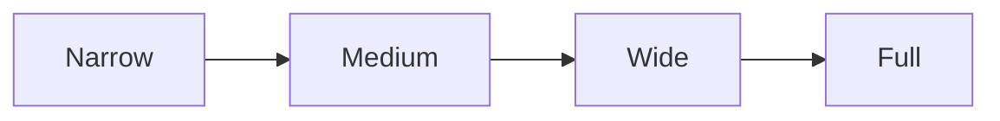

# Page layout

Open **Settings** and use the **Page layout** row (click it or its gear). Everything here is the reader's choice, laid over the theme, and it is remembered and applied to every page.

| Choice | Options |
|---|---|
| Width | theme default (980 px), Narrow 720, Medium 900, Wide 1240, Full window |
| Text size | 70% to 200% in steps; only the document zooms, the toolbar and panels keep their size |
| Spacing | theme default, Compact, Relaxed, Airy |
| Font | theme default, Sans-serif, Serif, Monospace (system fonts only, nothing is downloaded) |

Keys: `+` and `-` change the text size, `0` restores it, `W` cycles the width.

The **contents panel** sits in a side column while there is room beside the page. Choose Wide or Full window (or shrink the window) and it becomes the inline **Contents** button above the page instead.

Printing ignores the zoom, so a printout is the same whatever the screen setting.

## Something long enough to see the difference

Lorem ipsum dolor sit amet, consectetur adipiscing elit, sed do eiusmod tempor incididunt ut labore et dolore magna aliqua. Ut enim ad minim veniam, quis nostrud exercitation ullamco laboris nisi ut aliquip ex ea commodo consequat. Duis aute irure dolor in reprehenderit in voluptate velit esse cillum dolore eu fugiat nulla pariatur.

Excepteur sint occaecat cupidatat non proident, sunt in culpa qui officia deserunt mollit anim id est laborum. Sed ut perspiciatis unde omnis iste natus error sit voluptatem accusantium doloremque laudantium, totam rem aperiam.

## A table and a diagram

| Name | Role | Notes |
|---|---|---|
| Ada | Engineer | writes the compilers |
| Grace | Admiral | found the bug |



## Code

```js
const layout = { width: "wide", zoom: 125, spacing: "relaxed", font: "serif" }
```
