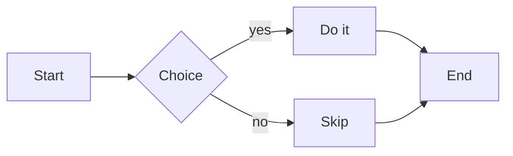
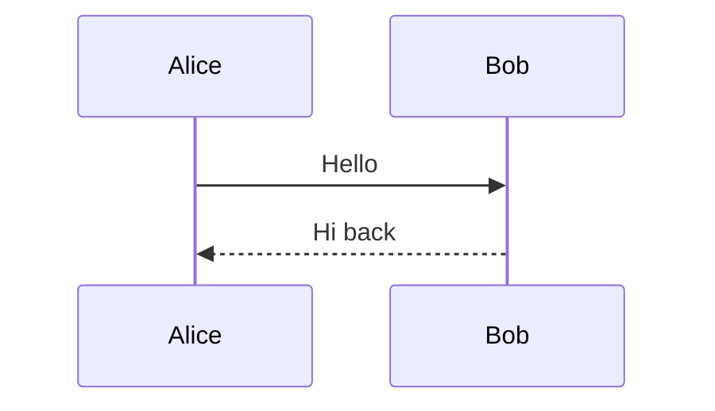
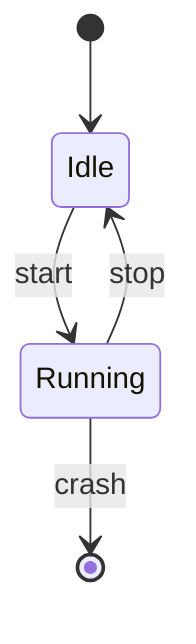
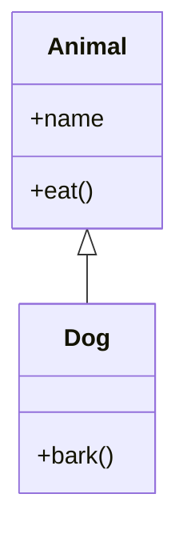
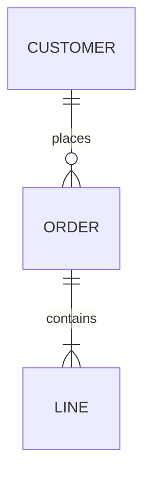
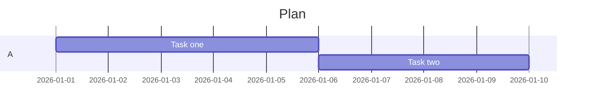
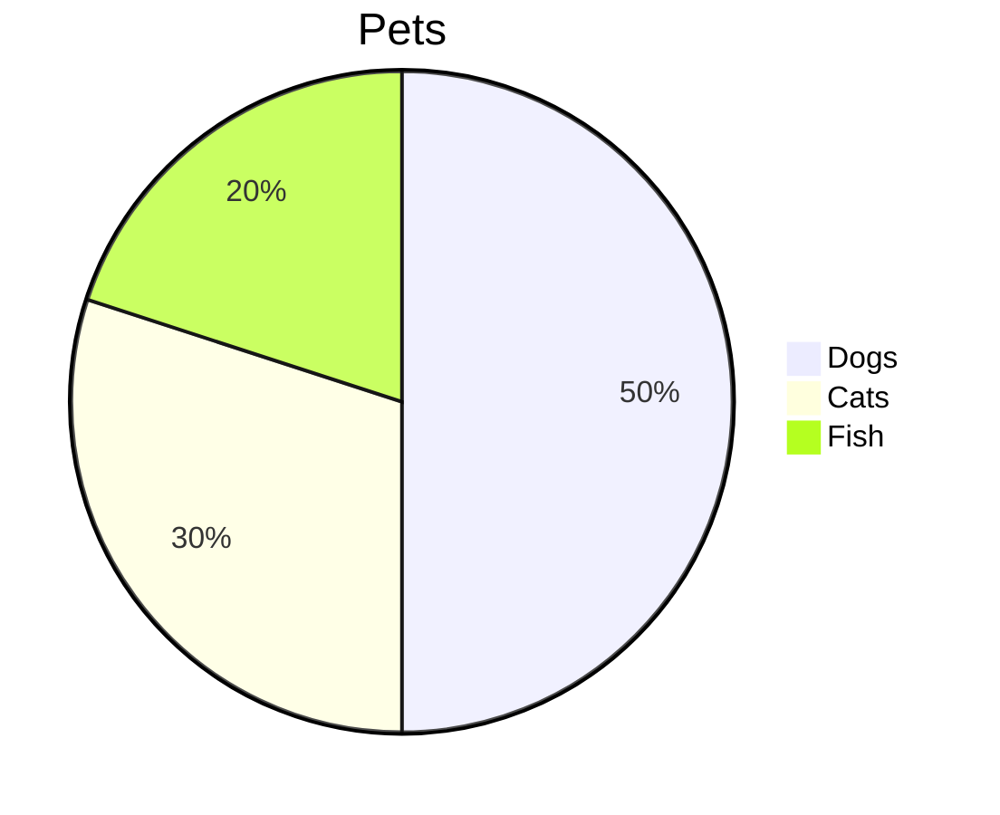

# Mermaid

## Flowchart



## Sequence



## State



## Class



## Entity relationship



## Gantt



## Pie



## A diagram with a mistake

```mermaid
flowchart LR
    A --> 
    this is not valid %%%
```

The last one shows a readable error with the source, instead of a blank space.
