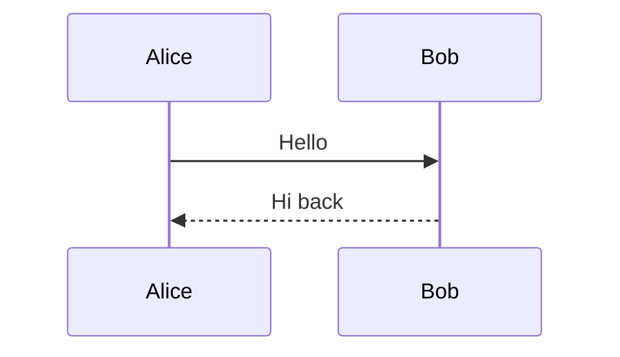
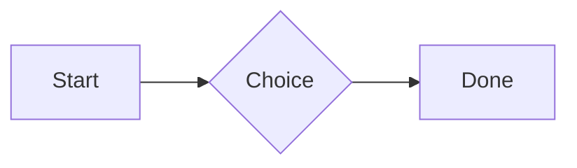
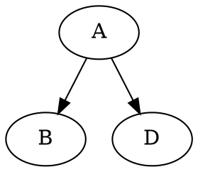

# Sample Document

This is a *sample* document for exercising mt-md.

## Core Markdown

| Col A | Col B |
|---|---|
| 1 | one |
| 2 | two |

- [x] task done
- [ ] task open

Footnote here.[^1]

Strikethrough: ~~old~~. Sub: H~2~O. Sup: x^2^.

[^1]: A footnote.

## Diagrams





## Details and code

Some `inline code` and a fenced block:

```js linenums hl_lines="2 3"
function hello(name) {
  const msg = `hello, ${name}`
  return msg
}
console.log(hello("world"))
```

> [!NOTE]
> An informational note.

> [!WARNING]
> Something to be careful about.

> [!TIP]
> A helpful suggestion.

+++ Click to expand

Hidden content here, including a **list**:

- one
- two

+++



Inline math $E = mc^2$ and a price of $5 and $10 stay text.

$$\int_{-\infty}^{\infty} e^{-x^2} \, dx = \sqrt{\pi}$$
